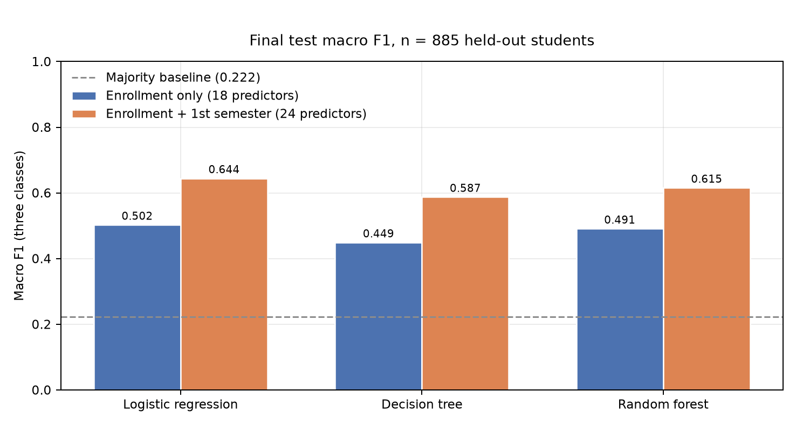
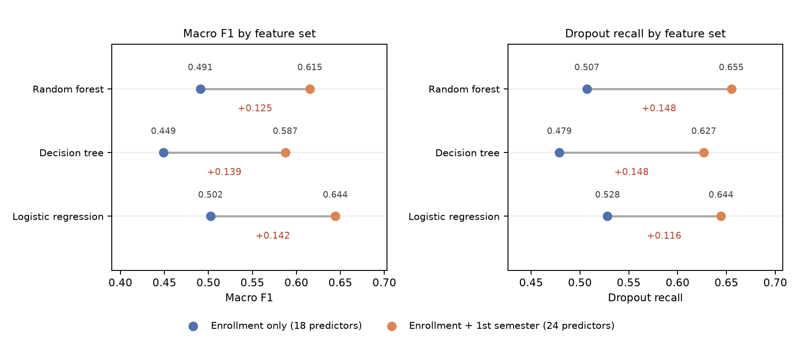
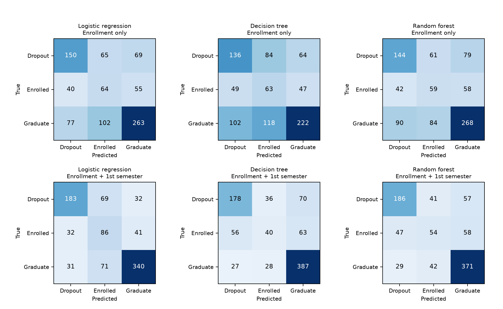
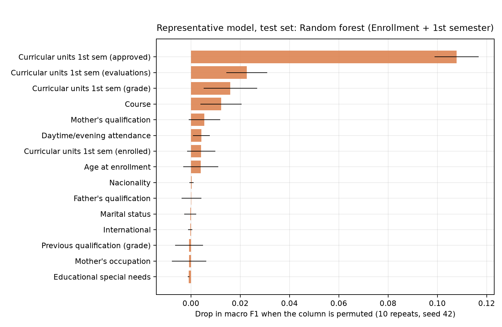
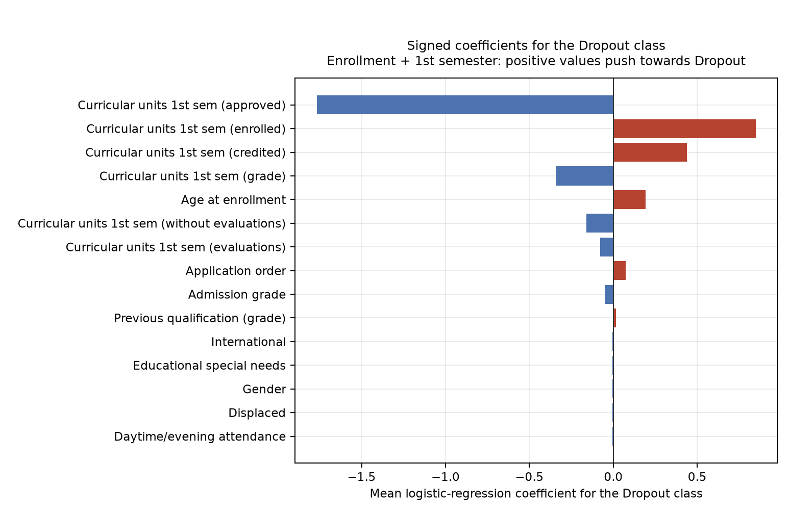

# C stage findings — one-shot evaluation on the 885 held-out students

Status: complete, pending team acceptance. Every number below comes from the single
evaluation run recorded in `results/C_final/run_manifest.json`; no model was refitted,
retuned, re-split or reselected at this stage.

## What was evaluated and under which rules

Six frozen pipelines from B (`models/<feature_set>__<model>.joblib`) and B's shared
majority-class baseline were applied unchanged to the 885 test rows of
`data/splits/split_manifest.csv` (`dataset_split == test`). Each model was scored against
its own declared feature list, and probabilities were mapped through the loaded
`pipeline.classes_` rather than by column position.

The representative model used for the interpretation figures is the one B fixed before
seeing any test score: `models/enrollment_plus_sem1__random_forest.joblib`
(validation macro-F1 0.644883 ± 0.017185). It is not re-chosen here, even though the test
ranking puts logistic regression slightly ahead.

Test composition: 885 rows, 284 Dropout (32.1%), 159 Enrolled (18.0%), 442 Graduate (49.9%).
A model that always answers "Graduate" therefore already reaches 0.499 accuracy, which is
why macro-F1 rather than accuracy is the selection metric.

## Question 1 — how much does first-semester information actually add?



| Feature set | Model | Test macro-F1 | Dropout precision | Dropout recall | Accuracy |
|---|---|---:|---:|---:|---:|
| Enrollment only (18) | Logistic regression | 0.5024 | 0.5618 | 0.5282 | 0.5390 |
| Enrollment only (18) | Decision tree | 0.4488 | 0.4739 | 0.4789 | 0.4757 |
| Enrollment only (18) | Random forest | 0.4907 | 0.5217 | 0.5070 | 0.5322 |
| Enrollment + 1st semester (24) | Logistic regression | 0.6442 | 0.7439 | 0.6444 | 0.6881 |
| Enrollment + 1st semester (24) | Decision tree | 0.5873 | 0.6820 | 0.6268 | 0.6836 |
| Enrollment + 1st semester (24) | Random forest | 0.6153 | 0.7099 | 0.6549 | 0.6904 |
| Shared baseline | Majority class | 0.2221 | 0.0000 | 0.0000 | 0.4994 |



Adding the 24-variable semester-1 block raises test macro-F1 by **+0.125 to +0.142** for
every model family (logistic regression +0.142, decision tree +0.139, random forest +0.125),
and dropout recall by +0.116 to +0.148. The direction and rough size of the gain match the
validation stage, so the improvement is not an artefact of the held-out split: the same
six pipelines reproduce a gap of 0.121–0.146 on data no model was tuned on.

However, every model still misses roughly one dropout student in three. The best dropout
recall is 0.655 (random forest, 24 variables), i.e. 98 of the 284 true dropouts in the test
set are not flagged. Semester-1 grades carry real but not decisive signal.

## Question 2 — which frozen model should the team ship, and did validation ranking survive?

| Model | Feature set | CV macro-F1 (B) | Test macro-F1 | Change |
|---|---|---:|---:|---:|
| Logistic regression | Enrollment only | 0.5235 | 0.5024 | −0.0211 |
| Decision tree | Enrollment only | 0.4552 | 0.4488 | −0.0064 |
| Random forest | Enrollment only | 0.5190 | 0.4907 | −0.0283 |
| Logistic regression | Enrollment + sem-1 | 0.6444 | 0.6442 | −0.0002 |
| Decision tree | Enrollment + sem-1 | 0.6016 | 0.5873 | −0.0143 |
| Random forest (B's representative) | Enrollment + sem-1 | 0.6449 | 0.6153 | −0.0296 |

Five of six models lose a little on the test set and one is flat, which is the expected
direction when the same data chose the hyper-parameters: the cross-validated number is
mildly optimistic. The average shrinkage is about 0.017 macro-F1.

The ranking is *not* perfectly stable at the top. B's representative random forest drops
0.030 while logistic regression on the same 24 variables holds its validation level, so on
the test set logistic regression leads by 0.029 (0.6442 vs 0.6153). That margin is smaller
than the fold-to-fold spread B reported (±0.016 and ±0.017) and smaller than the average
CV-to-test drift, so it must be reported as a tie inside noise, not as a new winner.
Because B fixed the representative model before test access, it stays the representative
model; switching now would convert a descriptive test comparison into post-hoc selection.
The decision-relevant claim is the one that survived: on the richer feature set, random
forest and logistic regression are statistically indistinguishable, both clearly above
the decision tree (0.5873) and the baseline (0.2221).

For an operational default the safer description is "logistic regression or random forest
on the 24 variables", with the choice justified by validation numbers rather than by the
0.029 test difference.

## Question 3 — is the operating point usable for flagging at-risk students?



Class-level behaviour, not just the macro average, decides usability:

- **Dropout** is detected reasonably. With 24 variables, dropout precision is 0.68–0.74 and
  recall 0.63–0.66; about three of four flagged students really are dropouts, and about two
  of three dropouts are flagged. That is a usable screening trade-off for a support
  intervention that is cheap and non-punitive.
- **Graduate** is the easy class (F1 0.795–0.805 with 24 variables): the model rarely
  invents graduates, and its graduate recall is 0.77–0.88.
- **Enrolled** is the weak class in every model (F1 0.30–0.45). With only 159 test cases,
  the middle class is systematically confused with both neighbours: logistic regression
  recalls 0.54 of Enrolled but only 0.38 precision, and the decision tree collapses to 0.25
  recall. Any claim about "three-class prediction" should be softened to "dropout versus
  rest is reliable; the Enrolled band is not".
- **False reassurance differs sharply between the two leading models**, and this is the main
  argument for preferring logistic regression in an at-risk screening role. Of the 284 true
  dropouts, logistic regression labels 32 as Graduate, random forest 57 and the decision tree
  70 — a factor of two between models whose macro-F1 differs by only 0.03. The rest of the
  dropout errors go to Enrolled (69, 41 and 36 respectively), which still triggers a review.
  If an intervention is offered to every flagged or uncertain student, the difference is
  tolerable; if students below a threshold are silently dropped from support, it is not.
- **Probabilities are only calibrated for logistic regression.** Its test log-loss is 0.729
  (24 variables) and 0.972 (18 variables). Tree ensembles return hard 0/1 leaf proportions
  and are recorded with an empty `log_loss`, so they must not be used to rank students by
  "risk percentage" without recalibration.

## What drives the prediction



Permutation importance for the representative random forest (macro-F1 drop, 10 repeats,
seed 42) concentrates almost entirely on first-semester academic performance:

| Feature | Mean drop in macro-F1 | SD |
|---|---:|---:|
| Curricular units 1st sem (approved) | 0.1078 | 0.0090 |
| Curricular units 1st sem (evaluations) | 0.0226 | 0.0083 |
| Curricular units 1st sem (grade) | 0.0160 | 0.0109 |
| Course | 0.0122 | 0.0083 |
| Mother's qualification | 0.0055 | 0.0064 |

The approved-unit count alone accounts for five times the next feature. Background
variables (parents' qualification and occupation, nationality, marital status, special
needs) sit at or below the noise floor, and some importances are negative, which is normal
for permutation importance on correlated columns.



The logistic-regression coefficients for the Dropout class agree on the mechanism and add
a sign: approved units are strongly protective (−1.77), while *enrolled* (+0.85) and
*credited* (+0.44) units push towards dropout, and first-semester grade is protective
(−0.34). In plain terms, students who sign up for many units but convert few of them into
approvals — and who are older at enrolment (+0.19) — are the ones the model flags. That is
consistent with A's descriptive finding that the semester-1 approval rate separates
outcomes far more than any demographic field, and it gives the advising service an
actionable, non-circular lever: unit load versus approval conversion.

Two caveats belong with this reading. First, both explanations are computed on the test
set, so they describe this model on this sample, not a causal mechanism; permutation
importance also inflates correlated features and deflates their partners. Second, the
"credits" and "enrolled" effects are partly mechanical: the same student cannot approve
units they never enrolled in.

## Threats to validity

1. **Selection optimism.** Hyper-parameters and the representative model were chosen on the
   same 3,539 training rows that produced the CV scores. Test macro-F1 is therefore the
   honest number, and the CV numbers in the table above should not be quoted as expected
   field performance.
2. **Single split, no test-side uncertainty.** One 885-row test set gives no confidence
   interval here; with 284 dropouts, a ±0.02 macro-F1 swing is well inside sampling noise.
3. **Enrolled class.** 159 test cases and F1 near 0.35 mean the three-class claim is weaker
   than the headline macro-F1 suggests.
4. **Retrospective semester-1 data.** The dataset has no withdrawal date, so this is not a
   real-time early-warning system: semester-1 results only exist after the student has
   already been enrolled for a term.
5. **Institutional scope.** One Portuguese polytechnic, 2008–2019 enrolments, 4,424 records.
   No claim of transfer to other institutions or cohorts is supported.
6. **Protected attributes.** Course, age, nationality, parents' qualification and
   occupation are inputs. The model is a screening aid for support offers, not a basis for
   denying anything to a student; any deployment needs a human review step and a check for
   disparate flagging rates.
7. **Byte-level provenance.** Each of the seven upstream inputs must match either the bytes
   B recorded or the same content after CRLF/LF normalisation (the LF-canonical SHA-256
   equals both A's and B's recorded digest). A Windows clone of B's branch reproduces the
   first case; the LF-exported working copy that produced the first run was the second.
   `evaluate_models.py` accepts exactly these states, records the per-file `byte_status` in
   `run_manifest.json`, and refuses any other difference. `data/manifest.json` describes the
   files beside it, so it is re-validated from its own listing rather than hashed against
   itself.

## Reproducing this stage

```powershell
python src/C_evaluation/evaluate_models.py --check   # verify upstream only, scores nothing
python src/C_evaluation/verify_C.py                  # recheck delivery and recompute metrics
python src/C_evaluation/evaluate_models.py           # full run (refuses to overwrite existing results)
```

The full run took about 24 s on Windows AMD64 with Python 3.14.3 and the A-locked
dependencies. `--skip-figures` reproduces the two CSVs and the manifest only;
`--force` is required to replace an existing `results/C_final/`.

## Deliverables in this folder

| File | Content |
|---|---|
| `test_metrics.csv` | Seven rows, one per model/feature-set combination plus baseline, 19 columns |
| `test_predictions.csv` | 6,195 rows = 885 students × 7 model rows, long format with three class probabilities |
| `figures/01_test_macro_f1_by_model.png` | Grouped macro-F1 comparison with the baseline line |
| `figures/02_feature_set_gain.png` | Dumbbell chart of the 18 → 24 variable gain per model |
| `figures/03_confusion_matrices.png` | Six confusion matrices on the test set |
| `figures/04_interpretation_random_forest.png` | Permutation importance, representative model |
| `figures/05_interpretation_logistic_regression.png` | Signed Dropout-class coefficients, 24 variables |
| `permutation_importance_representative.csv` | Full importance table behind figure 04 |
| `logistic_dropout_coefficients.csv` | Full coefficient table behind figure 05 |
| `run_manifest.json` | Frozen B reference, per-input byte status, model and output hashes, environment, command |
| `verification_report.json` | Output of `verify_C.py` |
